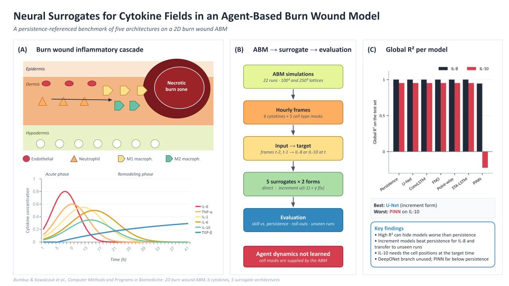

# Neural Surrogates for Cytokine Fields in an Agent-Based Burn Wound Model



[](https://doi.org/10.5281/zenodo.20457662)

> **Neural Surrogates for Cytokine Fields in an Agent-Based Burn Wound Model: a Persistence-Referenced Benchmark**  
> Roland V. Bumbuc\*, Julia Kowalczuk\*, Rezo Getsadze, Ioannis Papapanagiotou, H. Ibrahim Korkmaz, Vivek M. Sheraton  
> *Computer Methods and Programs in Biomedicine* (under review)  
> \*Equal contribution

---

## Overview

This repository contains the code and results of a benchmark of neural surrogates for the IL-8 and IL-10 fields of a hybrid agent-based model (ABM) of the post-burn immune response. The ABM couples CompuCell3D to FiPy.

The surrogates predict the next hourly field of one cytokine from the two preceding frames, each with six cytokine fields and five cell-type masks. The cell masks come from the ABM, so the agent dynamics are not learned.

Consecutive hourly frames of the ABM are almost identical, so a model that copies the last frame already reaches R² of 0.9999 for IL-8. All models are therefore compared with this persistence baseline:

```
skill = 1 - MSE_model / MSE_persistence
```

| Model | Role |
|---|---|
| **U-Net** | main benchmark |
| **ConvLSTM** | main benchmark |
| **Fourier neural operator (FNO)** | main benchmark |
| **STA-LSTM** | main benchmark |
| **Point-wise network** | main benchmark (the DeepONet trunk used on its own) |
| **DeepONet** | ablation only |
| **PINN** | physics-based reference |

Each of the five benchmark architectures is trained in two forms:
- **direct:** the network outputs the next frame;
- **increment:** the network outputs a correction that is added to the previous frame.

Each form has its own 20-trial Optuna search and is trained with three seeds, at lattice sizes of 100² and 250².

**Main results**

- **Persistence** reaches R² of 0.9999 (100²) and 0.9998 (250²) for IL-8, and 0.96 and 0.95 for IL-10.
- **Increment form, IL-8.** All five architectures beat persistence (skill 0.70-0.88 at 100², 0.59-0.95 at 250²). They stay accurate over 19 h roll-outs and keep their skill on unseen seeds and on runs with a wider boundary margin.
- **Direct form, IL-8.** The same architectures are worse than persistence, although their R² is above 0.99.
- **IL-10.** IL-10 is produced by a small number of moving M2 macrophages, and the gain over persistence is close to zero (skill 0.001-0.006). It rises to 0.07-0.25 when the models also receive the cell masks at the target time.
- **Frozen-weight transfer.** The U-Net is worse than persistence on runs with five times more endothelial cells at 250².
- **PINN.** With a residual, sources and boundary condition that match the ABM, it reaches R² of 0.91 (100²) and 0.94 (250²) for IL-8 and does not fit IL-10.

---

## Repository structure

```
├── abm/                          # ABM (CompuCell3D + FiPy) and the generator of the 22 runs, see abm/README.md
├── scripts/
│   ├── rev/                      # benchmark on the 22 ABM runs
│   │   ├── preprocess_runs.py    # ABM runs (VTK) -> arrays, one scaling per grid
│   │   ├── common.py             # data loading, metrics, persistence, roll-out
│   │   ├── run_main.py           # five architectures x {direct, increment}
│   │   ├── run_multitraj.py      # training on 1, 2 or 3 ABM runs
│   │   ├── run_grid_models.py    # U-Net variants (training-set size, loss weighting)
│   │   ├── run_lookback.py       # look-back window
│   │   ├── run_deeponet.py       # DeepONet ablation
│   │   ├── run_pinn_abm.py       # PINN, strict and softened residual
│   │   ├── run_pinn_dataonly.py  # PINN without PDE and boundary terms
│   │   ├── physics_step*.py      # re-implemented cytokine update of the ABM
│   │   ├── abm_variability.py    # run-to-run variability of the ABM
│   │   ├── check_*.py            # consistency checks
│   │   ├── aggregate*.py         # result JSONs -> tables
│   │   ├── collect_for_paper.py  # values quoted in the paper
│   │   └── post_runs.py          # tables and figures
│   ├── unet/, sta_lstm/, deeponet/, pinn/   # model implementations (also used by scripts/rev)
│   ├── metrics.py                # metrics (also used by scripts/rev)
│   └── pi_deeponet/, preprocessing*.py, lookback.py, figures.py, eda.py   # earlier single-simulation experiments
├── sensitivity/                  # clipping sensitivity (single-simulation experiments)
├── results/
│   ├── rev_abm/                  # benchmark: all models except the PINN
│   ├── rev_abm_pinn/             # benchmark: PINN (strict, soft, data only)
│   └── models/, sensitivity/, ...  # single-simulation experiments (hyperparameters reused by scripts/rev)
├── outputs/
│   ├── figures/                  # generated figures
│   ├── figures_edited/           # figures as used in the paper
│   ├── rev_abm/                  # tables of the paper
│   └── eda/, metrics/            # single-simulation analyses
├── submit_main.sh                # Snellius: preprocessing, main models, ablation
├── submit_tmask_and_figures.sh   # Snellius: target-time masks, tables and figures
├── submit_pinn.sh                # Snellius: PINN, physics check
├── paths.py                      # path configuration
└── requirements.txt
```

---

## Reproducing the results

### 1. Install

Python 3.11 with TensorFlow 2.15 was used. A GPU is needed for training.

```bash
python -m venv .venv
source .venv/bin/activate
pip install -r requirements.txt
```

### 2. ABM runs

The benchmark uses 22 ABM simulations of 100 h each (101 hourly frames), all at both 100² and 250². The configurations have the names used in the paper (Table 1) and an identifier used in the data archive and in this repository:

| Configuration (paper) | Identifier | Change from the baseline | Seeds |
|---|---|---|---|
| Baseline | `E3_il10_from_m2` | none | 1-5 |
| Five-fold endothelial cells | `E2a_endothelial_x5_m2` | five times more endothelial cells | 1-3 |
| Wider boundary margin | `E2b_geometry_margin_G5_m2` | boundary margin b = G/5 instead of G/10 | 1-3 |

Baseline seed 1 is the only run used for training; baseline seeds 2-5 are the "unseen seeds". The runs were generated with the ABM in `abm/`, in which IL-10 is secreted by M2 macrophages (the suffix `_m2` of the identifiers). The boundary margin b sets the length of the zero-concentration boundary segments and where cells are placed (see `abm/README.md`).

The runs are archived on Zenodo ([10.5281/zenodo.24355550](https://doi.org/10.5281/zenodo.24355550)) as the file `burn_wound_abm_simulations.tar.gz`. Download it into the root of this repository and extract it there; each run is then a folder `burn_wound_abm_simulations/runs/<experiment>_G<grid>_s<seed>/` with `LatticeData/Step_*.vtk`.

```bash
tar -xzf burn_wound_abm_simulations.tar.gz
python scripts/rev/preprocess_runs.py --runs-root burn_wound_abm_simulations/runs --out preprocessed_abm
```

The scripts read `preprocessed_abm/` and write to `results/rev_abm/` by default; set `REV_DATA_ROOT` or `REV_OUT` to use other folders.

All runs of a grid are scaled with the constants of the training run, so trained models can be applied to the other runs with frozen weights.

If the concentration scale of a modified configuration differs from that of the training run by more than 25 % (here both modified configurations, at both grids), `preprocess_runs.py` also writes copies named `<identifier>-ownscale_G<grid>_s<seed>`. They are scaled in the same way with the constants of that configuration's seed 1. The paper reports the copies of the five-fold endothelial runs as "own scaling" (Table 5, Fig. 5); the wider-margin copies are evaluated but not reported.

### 3. Train and evaluate

```bash
# main benchmark: hyperparameter search, then seeds 42, 1 and 100, both forms, both cytokines
for M in unet convlstm fno stalstm pointwise; do
  for G in 100 250; do
    python scripts/rev/run_main.py --model $M --grid $G
  done
done

# models that also receive the cell masks at the target time
python scripts/rev/run_main.py --model unet --grid 100 --target-masks

# further experiments (U-Net hyperparameters are taken from the main search)
python scripts/rev/run_multitraj.py --grid 100
python scripts/rev/run_grid_models.py --model unet --grid 100 --variants weighted ntrain35 ntrain52
python scripts/rev/run_lookback.py --grid 100
python scripts/rev/run_deeponet.py --grid 100 --variants base no_branch no_gate no_fields --seeds 42 1 100

# PINN
python scripts/rev/run_pinn_abm.py --variant strict --grid 100
python scripts/rev/run_pinn_abm.py --variant soft --grid 100
python scripts/rev/run_pinn_dataonly.py --grid 100
```

Every result JSON contains:
- the one-step metrics for the near (82-91 h) and far (92-100 h) test windows;
- the persistence baseline and the skill;
- the 19 h roll-out;
- the frozen-weight results on the other runs.

Finished runs are skipped when a script is started again.

The trained weights and the predictions of these runs are archived on Zenodo as `surrogate_weights.tar` (23 GB) and `surrogate_predictions.tar` (2 GB), in a separate record linked to this repository. To use them instead of retraining, extract both in the root of this repository; every file goes next to the result file of the same model. Weights and predictions were not kept for every run; the record's README lists which are included.

### 4. Tables and figures

```bash
python scripts/rev/aggregate.py
python scripts/rev/aggregate_transfer.py
python scripts/rev/aggregate_pinn.py
python scripts/rev/post_runs.py          # figures -> outputs/figures
python scripts/rev/collect_for_paper.py  # -> outputs/rev_abm/for_paper.txt
```

### Data layout

| Path | Contents | In git | Produced by |
|---|---|---|---|
| `abm/` | ABM model, run design and provenance tools | yes | |
| `preprocessed_abm/<run>/` | model inputs of each ABM run (about 6 GB for the ten baseline runs) | no | `preprocess_runs.py`, from the Zenodo archive |
| `results/rev_abm/<model>/<variant>/res_<cytokine>_<grid>_<seed>.json`, `hp_<cytokine>_<grid>.json` | metrics, roll-outs, frozen-weight results and hyperparameters of every trained model | yes | `scripts/rev/run_*.py` |
| `results/rev_abm/<model>/<variant>/pred_<cytokine>_<grid>_<seed>.npz` | one-step predictions and roll-outs on the test window (2-13 MB each) | no | `scripts/rev/run_*.py`; also on Zenodo |
| `results/rev_abm/<model>/<variant>/weights_<cytokine>_<grid>_<seed>.weights.h5` | trained weights | no | `scripts/rev/run_*.py`; also on Zenodo |
| `outputs/rev_abm/` | aggregated tables (`summary.txt`, `for_paper.txt`, `post_runs_summary.txt`) | yes | step 4 |
| `outputs/figures/` | generated figures | PNG: yes | step 4 |
| `outputs/figures_edited/` | the figures as used in the paper, edited by hand from `outputs/figures/` (layout, panel letters) | PNG: yes | by hand |

`post_runs.py` builds most figures from the results JSON alone. Fig. 1 and Table 2 also need `preprocessed_abm/`. Fig. A.3 (error maps) needs `preprocessed_abm/` and the predictions of training seed 1 (`pred_*_1.npz`); to redraw only this figure, run `python -c "import post_runs as p; p.redraw_error_maps()"` in `scripts/rev`. The front statistics (`front_analysis.csv`) are averaged over all training seeds; if the predictions of some seeds are missing, `post_runs.py` reports the stored values instead of recomputing them. `collect_for_paper.py` copies the run provenance of the raw ABM runs from `REV_RUNS_ROOT` (default `~/burn_wound_abm_simulations/runs`).

Figure files in `outputs/figures` are named after their number in the paper; `FigA*` are the appendix figures. `Fig2_architectures` and `GraphicalAbstract` were drawn by hand and are not produced by `post_runs.py`.

### Snellius

`submit_main.sh`, `submit_tmask_and_figures.sh` and `submit_pinn.sh` submit the steps above as separate jobs on the `gpu_a100` partition. Set `REPO`, `RUNS` and `ACCOUNT` at the top of each script first.

---

## Data format

Each cytokine channel is clipped at a percentile chosen from its kurtosis and then mapped linearly to [-1, 1]. Below a kurtosis of 20 there is no clipping; above it, the 99.5th to 98th percentile is used. The mapping back to concentrations is:

```
u_phys = (u_scaled + 1) / 2 * c_max
```

The constants are stored in `metadata.json` of each preprocessed run. The ABM fields are amounts per voxel in pg; a voxel is 5/G cm wide with an assumed depth of 1 cm, so dividing by its volume, 25/G² mL, gives concentrations in pg/mL (as in the paper). Cell-type masks are binary and use the CompuCell3D type identifiers of the model: endothelial cells (1), resting neutrophils (2), activated neutrophils (5), M1 macrophages (8) and M2 macrophages (9).

The scripts for the single-simulation experiments (`scripts/preprocessing*.py`, `scripts/lookback.py`, `sensitivity/preprocess_*.py`) build the masks from types 1-5. In `endothelial.xml`, types 3, 4 and 5 are monocytes, fibroblasts and activated neutrophils.

---

## Citation

Roland V. Bumbuc and Julia Kowalczuk contributed equally to this work and share first authorship.

Paper:

```bibtex
@article{bumbuc2026surrogates2d,
  title   = {Neural Surrogates for Cytokine Fields in an Agent-Based Burn Wound Model:
             a Persistence-Referenced Benchmark},
  author  = {Bumbuc, Roland V. and Kowalczuk, Julia and Getsadze, Rezo and
             Papapanagiotou, Ioannis and Korkmaz, H. Ibrahim and Sheraton, Vivek M.},
  journal = {Computer Methods and Programs in Biomedicine},
  year    = {2026},
  note    = {Under review}
}
```

Code (all releases): [10.5281/zenodo.20457662](https://doi.org/10.5281/zenodo.20457662). ABM simulations: [10.5281/zenodo.24355550](https://doi.org/10.5281/zenodo.24355550).

---

## License

The code is released under the MIT License (see `LICENSE`). The ABM simulations and the trained models on Zenodo are released under CC BY 4.0. Questions: the corresponding author (v.s.muniraj@uva.nl).
